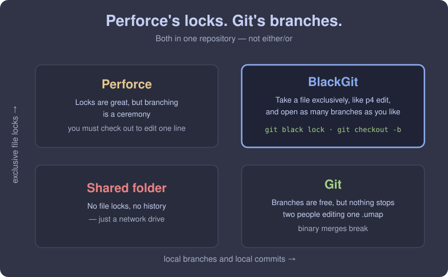

# BlackGit

[English](README.md) | [简体中文](README-zh.md) | [日本語](README-ja.md)

**Perforce のロックを、Git のブランチを、ひとつのリポジトリに。**

`p4 edit` のようにバイナリファイルを排他的に確保しながら、ローカルブランチは好きなだけ
作れる —— コミットはローカルのまま、ロックはサーバー側に置く。ロックが止めるのは `push`
だけで、ブランチやローカルコミットには一切触れない。

> **Status:** v0.0.2 · beta · MIT · Git 2.54+ 必須。CLI のみ（アーティスト向け GUI なし）、バイナリのチャンキング/重複排除はまだ未実装。


この録画の数値はすべて実測値：サーバー側 1.4 GB のリポジトリが、clone 直後は手元に
168 KB だけ残り、ひとつのファイルを `follow` して 60 MB になる。録画スクリプトは
[`docs/hero.tape`](docs/hero.tape)、[`docs/record.sh`](docs/record.sh) で再録できる。

🎥 一時停止したい場合や、誰かに送りたい場合（Slack、フォーラム、ブログ）：
[docs/hero.mp4](docs/hero.mp4) — 1 MB 未満、H.264、停止可能。README 上では GitHub が GIF しか
自動再生しないため、上には GIF を埋め込んでいる。

<details>
<summary>アニメーションが動かない？この図が同じことを説明しています</summary>



</details>

### 60 秒で試す

```bash
pip install blackgit                                   # クライアント
docker run -d -p 8081:8081 -v /data/blackgit:/data \
  -e BLACKGIT_UPSTREAM=https://github.com/you/game.git \
  ghcr.io/zhuzhonghua/blackgit:latest                  # サーバー

git black clone http://localhost:8081/game.git         # 1.4 GB リポジトリを 168 KB だけ
cd game
git black follow assets/levels/city.umap               # このファイルだけ取り込む
git black lock assets/levels/city.umap                # p4 edit のように排他確保
```

他の人が同じファイルを触もうとすると `already locked by <あなた>` が返り、その人の
`git push` はサーバーに拒否され、ロック保持者の名前が示される。

### 比較表

| | Plain Git | Git LFS | Perforce | BlackGit |
|---|---|---|---|---|
| ローカルな機能ブランチ | ✅ | ✅ | ❌ | ✅ |
| 排他ファイルロック | ❌ | アドバイザリ（クライアント側） | ✅ | ✅ サーバー強制、保持者を明示 |
| パス単位の読み取り権限 | ❌ | ❌ | ✅ | ✅（SVN authz 形式） |
| 1.4 GB リポジトリの clone | 全履歴 | 全履歴 + LFS スキャン | デポ全体 | **168 KB** |
| コスト | — | ホスティング帯域の枠 | 席ライセンス料 | MIT、セルフホスト |

### パイロットチームを募集しています

BlackGit は初期段階です。実際のゲーム/UE/VFX リポジトリで動かして、どこが壊れるか
フィードバックしてくれる **1〜2 チーム**を探しています。このリポジトリで issue を
上げてください — 営業電話ではなく、60 分の技術トライアルだけです。

---

## なぜ作ったのか

ゲームのリポジトリは巨大なバイナリ（`.umap`、`.uasset`、`.blend`、テクスチャ）で
あふれており、Git が一番痛い 2 つの問題に答えられない：**排他編集**（同じ `.umap` を
2 人のアーティストが開けば作業が消える）と**パス単位のアクセス制御**（アーティストに
リポジトリ全体のソースを引かせるべきではない）。

Perforce はロックをくれるが Git のようなブランチはなく、席ごとに課金される。Git は
ブランチをくれるがロックがない。BlackGit はその真ん中 — 素の Git の上に Perforce 式の
サーバー側ロックを載せる。

---

構成は分離した 2 つのパーツ — クライアントは開いたファイルだけを触り、サーバーが
ロックと権限を強制する：

- **クライアント（`git black`、Python）** — 素の git の薄いラッパー。`blob:none` と
  空の sparse-checkout（`!/* !/*/*`）で clone し、明示的に `follow` したファイルだけを
  展開する。LFS も、数 GB リポジトリの全履歴も不要。ミニエージェントで自然言語から
  操作することもできる。

- **サーバー（Docker）** — 標準 Git ホスト（GitHub/GitLab）の前段に置く smart-HTTP
  プロキシ。サーバー側でファイルロックを強制し、許可されたパス内の blob だけを
  配布する（SVN `authz` 形式）。commit と tree はこれまでどおり閲覧できる。

---

### 仕組み

BlackGit Cli（Python）はスタンドアロンでも使える。GitHub/GitLab リポジトリに直接
向かう場合はサーバーは不要だ。

BlackGit Server は標準的な **git smart-HTTP** エンドポイント（Netty + JGit）で、実際の
上流 origin をプロキシする。

```
git-black (blackgitcli.py)                        blackgit server (Netty + JGit)
  ordinary git + smart-http  ──────────────────▶  authenticates (Authorization: Basic)
  partial clone (blob:none)                        │
  sparse-checkout "cared files"                    ├─ read : blob allowlist by path (SVN authz format)
                                                   │         on-demand single-sha backfill from origin
                                                   │         download only needed sha
                                                   └─ write: canPush check + file-lock enforcement
                                                             proxy receive-pack to origin
                                                             replay the same body into the local cache
                                                                       │
                                                                       ▼
                                                                 origin (GitLab / GitHub)
                                                                 client's token forwarded verbatim
```

クライアントとサーバーは分離している：クライアントは**任意**の git smart-HTTP リモート
（ベア GitLab、GitHub、あるいは BlackGit 自身）に接続できる。

### 認証と認可

- **AuthN（認証）**：すべての smart-HTTP リクエストには `Authorization: Basic <user:token>`
  が必須。サーバーは自前の判断のためにユーザー名だけをデコードし、生のヘッダーはそのまま
  上流へ転送するので、上流では同じユーザーとして認証される。
- **AuthZ（読み取り）**：各リポジトリは `blackw-authz` ファイル（標準 SVN `authz` 形式：
  グループ、`@group`、`*`、`r`/`w`）を持てる。許可されたパスプレフィックスが blob
  許可リストになる —— **commit と tree は常に配布され**（履歴とディレクトリ閲覧は動き
  続ける）、`r` 許可のないパスの blob は通信レベルで拒否される。`blackw-authz` がなければ
  全 blob ダウンロード可（オープンモード）。
- **AuthZ（書き込み）**：push には `blackw-authz` 内のどこかに `w` 許可が必要。
  force-push と ref 削除は JGit が拒否する。`--read-only` はサーバー全体の push を拒否する。
- 許可リストは**到達可能な履歴**（tip だけではない）に対して計算・キャッシュされ、
  各 push 後に無効化される。
- **ファイルロック**：`git black lock <file>` はサーバー側で誰がロックしたかを記録する。
  その後、そのファイルに触れる push はロック保持者以外拒否される。
  `git black lock -d <file>` で解除。すでにロック済みファイルへの 2 度目のロック要求は
  現在の保持者を返す。

### クライアント：`git black`

`blackgitcli.py` は素の git の薄いラッパー — 通常の smart-HTTP で通信し、BlackGit
サーバーを一切必要としない。

| コマンド | 役割 |
|---------|--------------|
| `git black clone <url> [<dir>]` | `git init`、`origin` 設定、部分クローン（`blob:none`）設定、`fetch --depth=1`、ワークツリーを展開せずに HEAD をリモート tip に合わせ、空の sparse-checkout（`!/* !/*/*`）を準備 |
| `git black follow <path>…` | ファイル/ディレクトリを「気にかける」集合に追加；sparse-checkout がそれらの blob だけを展開（`-r` 再帰、`-d` 削除、`-l` 一覧） |
| `git black update` | 高速フォワードのみ：`--filter=tree:0` で commit を取得しブランチを動かし、気にかけるビューを再適用。分岐やワークツリーが汚れていれば素の `git pull` にフォールバック |
| `git black ls [<ref>|<path>|<branch>:<path>]` | blob を展開せずにツリーを一覧。サーバーがダウンロード権限のないパスを除外 |
| `git black lock <file>` | ファイルをロック（保持者だけがそのファイルへの変更を push 可） |
| `git black lock -d <file>` | ロック解除 |
| `git black branch` | ローカル + リモートブランチを現在ブランチ付きで一覧 |
| その他（`push`、`status`、`log`…） | 素の git へ引数そのまま透過 |

認証は git 標準の HTTP 層（credential helper / keychain / `http.extraHeader`）に任せる。
black は URL 内のユーザー情報を一切パースしない。気にかけるファイル集合は
`.git/blackw-add.tsv` に置かれ、純粋な**クライアント側ビュー**（ワークツリーに何を
展開するか）であり、本当の安全境界であるサーバー側 blob 許可リストとは独立している。

`BLACKGIT_QUIET=1` で git コマンドのトレース表示を隠せる（本体出力と git 出力は残る）。
スクリプト、パイプ、録画時に便利。

---

## インストール

### クライアント（git black）— pip

```bash
pip install blackgit
```

その後：

```bash
git black clone https://gitlab.example.com/group/repo.git
cd repo
git black follow src/engine        # サブツリーを気にかけ始める
git black update                   # commit だけ取得；tree/blob は必要時に
```

### サーバー — Docker（推奨）

ビルド済みイメージは GitHub Container Registry にある：

```bash
docker pull ghcr.io/zhuzhonghua/blackgit:latest
```

環境変数で起動（設定ファイル不要）：

```bash
docker run -d \
  -p 8081:8081 \
  -v /data/blackgit:/data \
  -e BLACKGIT_PORT=8081 \
  -e BLACKGIT_UPSTREAM=https://github.com/user/repo.git \
  ghcr.io/zhuzhonghua/blackgit:latest
```

環境変数：

| 変数 | デフォルト | 説明 |
|----------|---------|-------------|
| `BLACKGIT_PORT` | `8081` | リッスンポート |
| `BLACKGIT_ROOT` | `/data` | リポジトリキャッシュルート（ここにボリュームをマウント） |
| `BLACKGIT_UPSTREAM` | — | 上流 URL。初回起動時に空の bare リポジトリを自動生成 |
| `BLACKGIT_READ_ONLY` | off | `1` で全 push を拒否 |
| `BLACKGIT_TLS` | off | `1` で HTTPS 有効化 |
| `BLACKGIT_KEYSTORE` | — | TLS=1 時の keystore パス |
| `BLACKGIT_KEYSTORE_PASSWORD` | — | keystore パスワード |
| `BLACKGIT_KEY_PASSWORD` | — | キーパスワード |

### サーバー — ソースからビルド

```bash
lein uberjar
java -jar target/blackgit-*-standalone.jar \
     --port 8081 --root /path/to/repos \
     [--upstream https://github.com/user/repo.git] \
     [--tls --keystore … --keystore-password …] [--read-only]
```

`http://host:8081/repo.git` のような URL は `<root>/repo` に解決される。
`--upstream` を設定すると、サーバーは初回起動時に空の bare リポジトリを作り、
最初のクライアントリクエスト時に上流から refs を遅延取得する（josh と同じ戦略）。

---

### 技術スタック

- **サーバー**：Java 21、JGit 6.10、Netty 4.1。Leiningen でビルド。
- **クライアント**：Python 3。素の git サブプロセス。部分クローンに Git 2.54+ 必須。
- **トランスポート**：HTTP/1.1 上の git smart-HTTP（任意 TLS）。標準 HTTP(S) git のみ対応。
  非 HTTP 接続は最初のバイトで破棄される。
