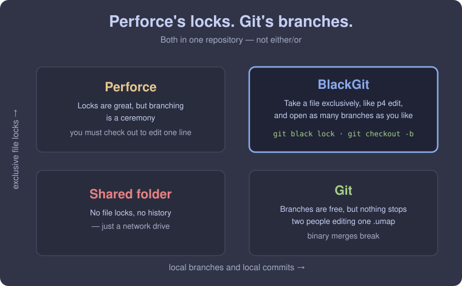

# BlackGit

[English](README.md) | [简体中文](README-zh.md) | [日本語](README-ja.md)

**P4 的锁，Git 的分支，在同一个仓库里。**

像 `p4 edit` 一样独占一个二进制文件，同时想开多少本地分支就开多少 ——
commit 在本地，锁在服务端。锁挡住的只有 `push`，你的分支和本地提交它一个字都不管。

> **状态：** v0.0.2 · beta · MIT · 需要 Git 2.54+。仅 CLI（无艺术家 GUI），暂不支持二进制分块/去重。


上面这段录屏里每个数字都是真跑出来的：1.4 GB 的服务端仓库，clone 结束你机器上只有 168 KB，
`follow` 一个文件才变成 60 MB。录屏脚本在 [`docs/hero.tape`](docs/hero.tape)，
用 [`docs/record.sh`](docs/record.sh) 可以重录。

📹 想暂停、或者发给别人（Slack、论坛、博客）：[docs/hero.mp4](docs/hero.mp4) ——
不到 1 MB，H.264，可暂停。（GitHub README 只会自动播放 GIF，所以上面嵌的是 GIF。）

<details>
<summary>动画没动？同一件事，这张图说完了</summary>



</details>

### 60 秒自己跑一遍

```bash
pip install blackgit                                   # 客户端
docker run -d -p 8081:8081 -v /data/blackgit:/data \
  -e BLACKGIT_UPSTREAM=https://github.com/you/game.git \
  ghcr.io/zhuzhonghua/blackgit:latest                  # 服务端

git black clone http://localhost:8081/game.git         # 1.4 GB 仓库，只落 168 KB
cd game
git black follow assets/levels/city.umap               # 只要这一个文件
git black lock assets/levels/city.umap                  # 像 p4 edit 一样独占它
```

别人再 `git black lock` 同一个文件会得到 `already locked by <你>`；
他的 `git push` 会被服务端拒绝，并告诉他锁在谁手上。

### 对比一下

| | 原生 Git | Git LFS | Perforce | BlackGit |
|---|---|---|---|---|
| 本地功能分支 | ✅ | ✅ | ❌ | ✅ |
| 独占文件锁 | ❌ | 仅建议（客户端） | ✅ | ✅ 服务端强制，指明持有者 |
| 路径级读权限 | ❌ | ❌ | ✅ | ✅（SVN authz 格式） |
| clone 一个 1.4 GB 仓库 | 完整历史 | 完整 + LFS 扫描 | 整个 depot | **168 KB** |
| 成本 | — | 托管带宽配额 | 按席位授权费 | MIT，自托管 |

### 寻找试点团队

BlackGit 还很早期。我们正在找 **1-2 个游戏 / UE / VFX 团队**，愿意拿真实仓库跑一遍，告诉我们哪里会崩。直接在本仓库开 issue——不是销售电话，只是一次 60 分钟的技术试用。

---

## 为什么做这个

游戏仓库塞满了大体积二进制文件（`.umap`、`.uasset`、`.blend`、贴图），而 Git 对最痛的两件事毫无办法：**独占编辑**（两个美术同时打开同一个 `.umap` 就会丢工作）和**路径级访问控制**（美术不该把整个仓库的源码都拉下来）。

Perforce 给你锁，但不给 Git 那样的分支，还要按席位收费。Git 给你分支，但没有锁。BlackGit 卡在中间——在原生 Git 之上加 Perforce 式的服务端锁。

---

它由两个解耦的部分组成——客户端只落地你打开的文件，服务端负责强制锁和权限：

- **客户端（`git black`，Python）**——原生 git 的薄封装。以 `blob:none` 和空 sparse-checkout（`!/* !/*/*`）克隆，之后只 materialize（落地）你显式 `follow` 的文件。不需要 LFS，也不需要多 GB 仓库的完整历史。还有一个迷你 agent，可以用自然语言驱动它。

- **服务端（Docker）**——前置在标准 Git 托管（GitHub/GitLab）之前的 smart-HTTP 代理。在服务端强制文件锁，并只下发你授权路径内的 blob（SVN `authz` 格式），同时 commit 和 tree 仍然可导航。

---

### 工作原理

BlackGit Cli（Python）可以独立使用，处理 GitHub/GitLab 仓库。

BlackGit Server 是一个标准 **git smart-HTTP** 端点（Netty + JGit），代理一个真实的上游 origin。

```
git-black (blackgitcli.py)                        blackgit server (Netty + JGit)
  ordinary git + smart-http  ──────────────────▶  authenticates (Authorization: Basic)
  partial clone (blob:none)                        │
  sparse-checkout "cared files"                    ├─ read : blob allowlist by path (SVN authz format)
                                                   │         on-demand single-sha backfill from origin
                                                   │         download only needed sha
                                                   └─ write: canPush check + file-lock enforcement
                                                             proxy receive-pack to origin
                                                             replay the same body into the local cache
                                                                       │
                                                                       ▼
                                                                 origin (GitLab / GitHub)
                                                                 client's token forwarded verbatim
```

客户端与服务端解耦：客户端可以对接**任何** git smart-HTTP 远端（裸 GitLab、GitHub，或 BlackGit 本身）。

### 认证与授权

- **AuthN（认证）**：每个 smart-HTTP 请求都必须携带 `Authorization: Basic <user:token>`。
  服务端只解码用户名用于自身决策；
  原始请求头会原样转发给上游，因此上游以同一用户身份完成认证。
- **AuthZ（读授权）**：每个仓库可以携带一个 `blackw-authz` 文件，使用标准 SVN `authz` 格式（组、`@group`、`*`、`r`/`w`）。
  用户被授予的路径前缀构成 blob 白名单：**commit 和 tree 始终照常提供**（历史与目录导航不受影响），
  但路径未被 `r` 授权覆盖的 blob 会在传输层被拒绝。
  若没有 `blackw-authz` 文件，则所有 blob 均可下载（开放模式）。
- **AuthZ（写授权）**：push 需要在 `blackw-authz` 中的某个位置有 `w` 授权。
  force-push 和删除 ref 会被 JGit 拒绝。`--read-only` 会在全服务器范围内拒绝所有 push。
- 白名单基于**可达历史**（而不只是 tip）计算并缓存；每次 push 后失效重建。
- **文件锁**：`git black lock <file>` 在服务端记录谁锁定了某个文件。之后触及该文件的 push 会被拒绝，除非来自锁持有者。`git black lock -d <file>` 解锁。对已锁定文件再次加锁会返回当前锁持有者。

### 客户端：`git black`

`blackgitcli.py` 是原版 git 的薄封装——它使用普通 smart-HTTP，且从不依赖 BlackGit Server。

| 命令 | 作用 |
|---------|--------------|
| `git black clone <url> [<dir>]` | `git init`，设置 `origin`，配置部分克隆（`blob:none`），`fetch --depth=1`，把 HEAD 指向远端 tip **而不** materialize 工作树，并启用空 sparse-checkout（`!/* !/*/*`） |
| `git black follow <path>…` | 把文件/目录加入你的"关注"（cared）集合；sparse-checkout 精确 materialize 这些 blob（`-r` 递归，`-d` 移除，`-l` 列表） |
| `git black update` | 仅快进：以 `--filter=tree:0` 抓取 commit，移动分支，重新应用关注视图；若已分叉或工作树脏，则回退到标准 `git pull` |
| `git black ls [<ref>|<path>|<branch>:<path>]` | 列出目录树而不 materialize blob；服务端会过滤掉调用者无权下载的路径 |
| `git black lock <file>` | 锁定文件（只有锁持有者能 push 对该文件的修改） |
| `git black lock -d <file>` | 解锁文件 |
| `git black branch` | 列出本地 + 远端分支，并标记当前分支 |
| 其他任何命令（`push`、`status`、`log`……） | 原样透传给原版 git，参数不变 |

认证交给 git 的标准 HTTP 层处理（credential helper / keychain / `http.extraHeader`）；black 从不解析 URL 中的用户信息。你的关注文件集合存放在 `.git/blackw-add.tsv`，纯粹是**客户端视图**（决定工作树里落地哪些文件），与服务端 blob 白名单相互独立——后者才是真正的安全边界。

设 `BLACKGIT_QUIET=1` 可以隐藏底层 git 命令的回显（程序自己的输出和 git 的输出都保留），脚本、管道和录屏时用得上。

---

## 安装

### 客户端（git black）— pip

```bash
pip install blackgit
```

然后：

```bash
git black clone https://gitlab.example.com/group/repo.git
cd repo
git black follow src/engine        # 开始关注一个子树
git black update                   # 只取 commit；tree/blob 按需获取
```

### 服务端 — Docker（推荐）

预构建镜像在 GitHub Container Registry 上：

```bash
docker pull ghcr.io/zhuzhonghua/blackgit:latest
```

用环境变量运行（无需配置文件）：

```bash
docker run -d \
  -p 8081:8081 \
  -v /data/blackgit:/data \
  -e BLACKGIT_PORT=8081 \
  -e BLACKGIT_UPSTREAM=https://github.com/user/repo.git \
  ghcr.io/zhuzhonghua/blackgit:latest
```

环境变量：

| 变量 | 默认值 | 说明 |
|----------|---------|-------------|
| `BLACKGIT_PORT` | `8081` | 监听端口 |
| `BLACKGIT_ROOT` | `/data` | 仓库缓存根目录（在此挂载卷） |
| `BLACKGIT_UPSTREAM` | — | 上游 URL，首次启动时自动引导创建一个空 bare 仓库 |
| `BLACKGIT_READ_ONLY` | 关闭 | 设为 `1` 时拒绝所有 push |
| `BLACKGIT_TLS` | 关闭 | 设为 `1` 时启用 HTTPS |
| `BLACKGIT_KEYSTORE` | — | TLS=1 时 keystore 路径 |
| `BLACKGIT_KEYSTORE_PASSWORD` | — | keystore 密码 |
| `BLACKGIT_KEY_PASSWORD` | — | key 密码 |

### 服务端 — 源码构建

```bash
lein uberjar
java -jar target/blackgit-*-standalone.jar \
     --port 8081 --root /path/to/repos \
     [--upstream https://github.com/user/repo.git] \
     [--tls --keystore … --keystore-password …] [--read-only]
```

类似 `http://host:8081/repo.git` 的 URL 会解析到 `<root>/repo`。若设置了 `--upstream`，服务端会在首次启动时创建空 bare 仓库，并在首个客户端请求时从上游惰性抓取 refs（与 josh 的策略相同）。

---

### 技术栈

- **服务端**：Java 21，JGit 6.10，Netty 4.1；用 Leiningen 构建。
- **客户端**：Python 3；纯 git 子进程调用。部分克隆需要 Git 2.54+。
- **传输层**：HTTP/1.1 之上的 git smart-HTTP（可选 TLS）。仅支持标准 HTTP(S) git；非 HTTP 连接会在收到第一个字节时被丢弃。
