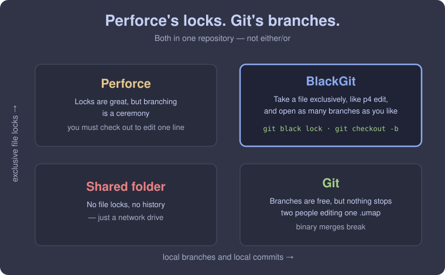

# BlackGit

[English](README.md) | [简体中文](README-zh.md) | [日本語](README-ja.md)

**Perforce's locks. Git's branches. One repository.**

Take a binary file exclusively, exactly like `p4 edit`, and open as many local
branches as you like — commits stay local, the lock lives on the server. The
lock stops `push`; it never touches your branch or your local commits.

> **Status:** v0.0.2 · beta · MIT · requires Git 2.54+. CLI only (no artist GUI), no binary chunking/dedup yet.


Every number in that recording is a real run: a 1.4 GB server-side repository
leaves 168 KB on your laptop after the clone, and 60 MB once you `follow` one
file. The tape is [`docs/hero.tape`](docs/hero.tape); re-record it with
[`docs/record.sh`](docs/record.sh).

🎥 Want to pause it, or send it to someone (Slack, a forum, a blog):
[docs/hero.mp4](docs/hero.mp4) — under 1 MB, H.264, pausable. The GIF is
embedded above because GitHub only autoplays GIFs in a README.

<details>
<summary>Animation not moving? This picture says the same thing</summary>



</details>

### Try it in 60 seconds

```bash
pip install blackgit                                   # client
docker run -d -p 8081:8081 -v /data/blackgit:/data \
  -e BLACKGIT_UPSTREAM=https://github.com/you/game.git \
  ghcr.io/zhuzhonghua/blackgit:latest                  # server

git black clone http://localhost:8081/game.git         # 1.4 GB repo, 168 KB kept
cd game
git black follow assets/levels/city.umap               # take just this one file
git black lock assets/levels/city.umap                  # take it exclusively
```

Anyone else asking for that file gets `already locked by <you>`, and their
`git push` is refused by the server, which names the lock holder.

### How it compares

| | Plain Git | Git LFS | Perforce | BlackGit |
|---|---|---|---|---|
| Local feature branches | ✅ | ✅ | ❌ | ✅ |
| Exclusive file lock | ❌ | advisory (client-side) | ✅ | ✅ server-enforced, holder named |
| Path-level read permissions | ❌ | ❌ | ✅ | ✅ (SVN authz format) |
| Clone a 1.4 GB repo | full history | full + LFS scan | whole depot | **168 KB** |
| Cost | — | hosting bandwidth quota | per-seat license | MIT, self-hosted |

### Looking for pilot teams

BlackGit is early. We're looking for **1–2 game / UE / VFX teams** willing to run it against a real repo and tell us where it breaks. Open an issue on this repo — no sales call, just a 60-minute technical trial.

---

## Why

Game repos are full of large binaries (`.umap`, `.uasset`, `.blend`, textures), and Git has no answer for the two things that hurt most: **exclusive editing** (two artists opening the same `.umap` means lost work) and **path-level access control** (artists shouldn't pull the whole repo's source).

Perforce gives you locks but not Git's branching, and bills per seat. Git gives you branches but no locks. BlackGit sits between them — Perforce-style server locks on top of stock Git.

---

It has two decoupled halves — a client that only touches the files you open, and a server that enforces locks and permissions:

- **Client (`git black`, Python)** — a thin wrapper on stock Git. You clone with `blob:none` and an empty sparse-checkout (`!/* !/*/*`), then materialize only the files you explicitly `follow`. No LFS, no full history of a multi-GB repo. A mini agent also lets you drive it with natural language.

- **Server (Docker)** — a smart-HTTP proxy in front of a standard Git host (GitHub/GitLab). It enforces file locks server-side and hands out only blobs inside your authorized paths (SVN `authz` format), while commits and trees stay navigable.

---

### How it works

BlackGit Cli (Python) works standalone against any GitHub/GitLab repository — you don't need the server.

BlackGit Server is a standard **git smart-HTTP** endpoint (Netty + JGit) that proxies a real upstream origin.

```
git-black (blackgitcli.py)                        blackgit server (Netty + JGit)
  ordinary git + smart-http  ──────────────────▶  authenticates (Authorization: Basic)
  partial clone (blob:none)                        │
  sparse-checkout "cared files"                    ├─ read : blob allowlist by path (SVN authz format)
                                                   │         on-demand single-sha backfill from origin
                                                   │         download only needed sha
                                                   └─ write: canPush check + file-lock enforcement
                                                             proxy receive-pack to origin
                                                             replay the same body into the local cache
                                                                       │
                                                                       ▼
                                                                 origin (GitLab / GitHub)
                                                                 client's token forwarded verbatim
```

The client and server are decoupled: client works against **any** git smart-HTTP remote (a bare GitLab, GitHub, or BlackGit itself).

### Authentication & authorization

- **AuthN**: every smart-HTTP request must carry `Authorization: Basic <user:token>`.
The server decodes only the username for its own decisions;
the raw header is forwarded to origin verbatim so upstream authenticates as the same user.
- **AuthZ (read)**: each repo may carry a `blackw-authz` file in standard SVN `authz` format (groups, `@group`, `*`, `r`/`w`).
The user's granted path prefixes become a blob allowlist: **commits and trees are always served** (history and directory navigation keep working),
but a blob whose path is not covered by an `r` grant is refused on the wire.
With no `blackw-authz` file, every blob is downloadable (open mode).
- **AuthZ (write)**: push requires a `w` grant somewhere in `blackw-authz`.
Force-push and ref deletion are rejected by JGit. `--read-only` rejects all pushes server-wide.
- The allowlist is computed over **reachable history** (not just the tip) and cached; it is invalidated after each push.
- **File locks**: `git black lock <file>` records who locked a file server-side. Subsequent pushes touching that file are rejected unless they come from the locker. `git black lock -d <file>` unlocks. A second lock on an already-locked file returns the current locker.

### The client: `git black`

`blackgitcli.py` is a thin wrapper around stock git — it talks ordinary smart-HTTP and never requires the BlackGit server.

| Command | What it does |
|---------|--------------|
| `git black clone <url> [<dir>]` | `git init`, set `origin`, configure partial clone (`blob:none`), fetch `--depth=1`, point HEAD at the remote tip **without** materializing the worktree, arm an empty sparse-checkout (`!/* !/*/*`) |
| `git black follow <path>…` | Add a file/dir to your "cared" set; sparse-checkout materializes exactly those blobs (`-r` recursive, `-d` remove, `-l` list) |
| `git black update` | Fast-forward only: fetch commits with `--filter=tree:0`, move the branch, re-apply the cared view; diverged or dirty worktree falls back to standard `git pull` |
| `git black ls [<ref>|<path>|<branch>:<path>]` | List the tree without materializing blobs; server filters out paths the caller cannot download |
| `git black lock <file>` | Lock a file (only locker can push changes to it) |
| `git black lock -d <file>` | Unlock a file |
| `git black branch` | List local + remote branches with the current branch marked |
| anything else (`push`, `status`, `log`, …) | Passed straight through to stock git, arguments unchanged |

Auth is left to git's standard HTTP layer (credential helper / keychain / `http.extraHeader`); black never parses user info out of the URL. Your cared-file set lives in `.git/blackw-add.tsv` and is purely a **client-side view** (what lands in your worktree). It is independent of the server-side blob allowlist, which is the actual security boundary.

Set `BLACKGIT_QUIET=1` to hide the trace of the underlying git commands (the program's own output and git's output both stay). Useful in scripts, pipes and screen recordings.

---

## Install

### Client (git black) — pip

```bash
pip install blackgit
```

Then:

```bash
git black clone https://gitlab.example.com/group/repo.git
cd repo
git black follow src/engine        # start caring about a subtree
git black update                   # commits only; trees/blobs on demand
```

### Server — Docker (recommended)

Pre-built images are on GitHub Container Registry:

```bash
docker pull ghcr.io/zhuzhonghua/blackgit:latest
```

Run with env vars (no config file needed):

```bash
docker run -d \
  -p 8081:8081 \
  -v /data/blackgit:/data \
  -e BLACKGIT_PORT=8081 \
  -e BLACKGIT_UPSTREAM=https://github.com/user/repo.git \
  ghcr.io/zhuzhonghua/blackgit:latest
```

Environment variables:

| Variable | Default | Description |
|----------|---------|-------------|
| `BLACKGIT_PORT` | `8081` | listen port |
| `BLACKGIT_ROOT` | `/data` | repo cache root (mount a volume here) |
| `BLACKGIT_UPSTREAM` | — | upstream URL, auto-bootstraps an empty bare repo on first start |
| `BLACKGIT_READ_ONLY` | off | set to `1` to reject all pushes |
| `BLACKGIT_TLS` | off | set to `1` to enable HTTPS |
| `BLACKGIT_KEYSTORE` | — | path to keystore when TLS=1 |
| `BLACKGIT_KEYSTORE_PASSWORD` | — | keystore password |
| `BLACKGIT_KEY_PASSWORD` | — | key password |

### Server — build from source

```bash
lein uberjar
java -jar target/blackgit-*-standalone.jar \
     --port 8081 --root /path/to/repos \
     [--upstream https://github.com/user/repo.git] \
     [--tls --keystore … --keystore-password …] [--read-only]
```

A URL like `http://host:8081/repo.git` resolves to `<root>/repo`. If `--upstream` is set, the server creates an empty bare repo on first start and lazily fetches refs from upstream on the first client request (same strategy as josh).

---

### Tech stack

- **Server**: Java 21, JGit 6.10, Netty 4.1; built with Leiningen.
- **Client**: Python 3; plain git subprocesses. Git 2.54+ required for partial clone.
- **Transport**: git smart-HTTP over HTTP/1.1 (optionally TLS). Only standard HTTP(S) git is supported; non-HTTP connections are dropped on first bytes.
